# ⚓ Schiffe versenken

**Das Klassiker-Duell fürs Wohnzimmer und unterwegs:** Schiffe versenken in Echtzeit, rundenbasiert – im Browser,
ohne App-Installation. Wahlweise in **verspieltem 3D** (three.js) oder als **gezeichnete Papierversion** auf kariertem Blatt.
Gegen Freunde, gegen Bots in drei Stärken oder als **Party am Fernseher** mit Handys als Controller.

Repo: <https://github.com/WTK1611/schiffe-versenken> · Lizenz: [PolyForm Noncommercial 1.0.0](LICENSE.md)
(frei nutzbar, änderbar, weitergebbar – **nicht kommerziell**) · Gestaltung und Raumlogik angelehnt an
[HitYear](https://github.com/WTK1611/hityear)

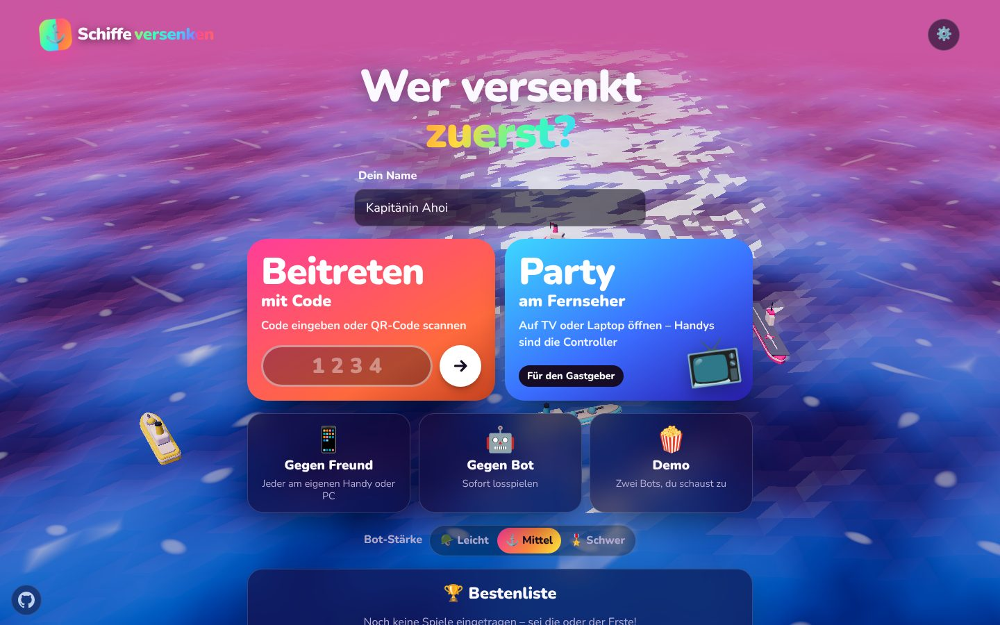

---

## Inhalt

- [So sieht es aus](#so-sieht-es-aus)
- [Spielmodi](#spielmodi)
- [So wird gespielt](#so-wird-gespielt)
- [Party am Fernseher](#party-am-fernseher)
- [Darstellung: 3D oder Papier](#darstellung-3d-oder-papier)
- [Bestenliste](#bestenliste)
- [Schnellstart](#schnellstart)
- [Technik](#technik)
- [Konfiguration & Betrieb](#konfiguration--betrieb)
- [Lizenz](#lizenz)

---

## So sieht es aus

**3D-Gefecht** – Granaten im Bogenflug, Explosionen, brennende Treffer, sinkende Wracks:

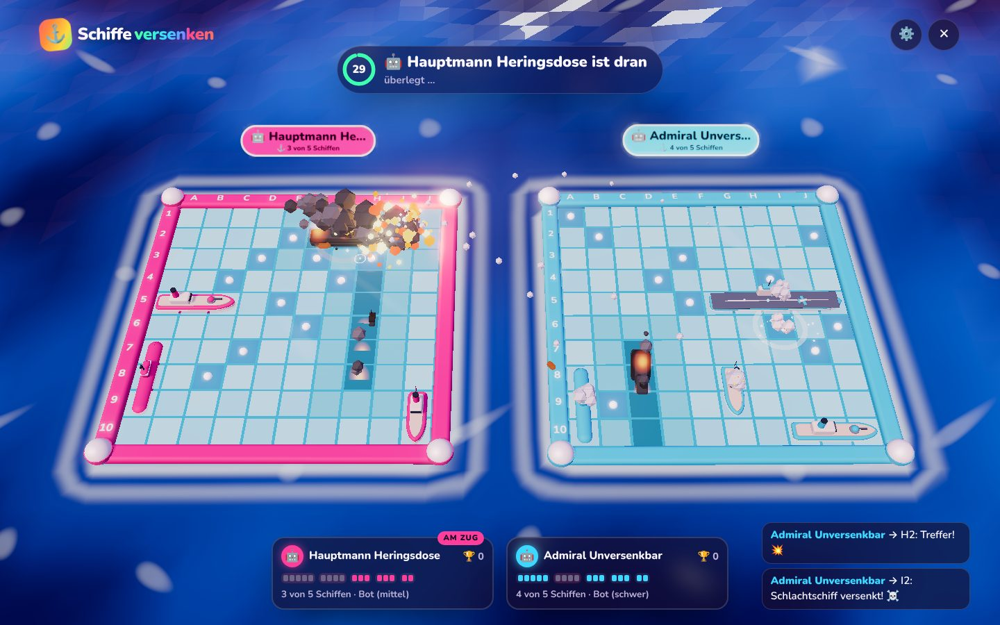

**Papierversion** – kariertes Blatt, Bleistiftstriche, rote Kreuze für Treffer, Punkte für Wasser:

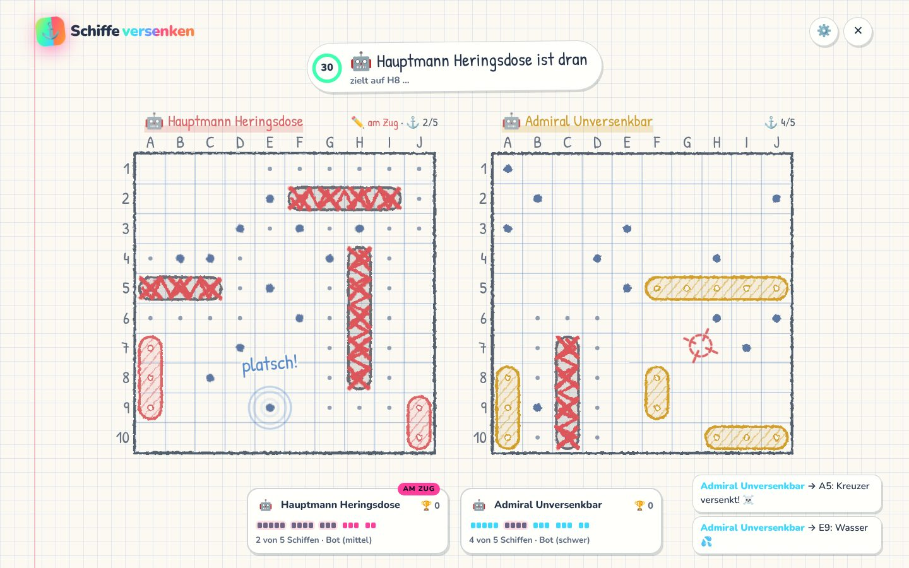

**Am Handy** – Startseite, Flotte platzieren, als Controller zielen und feuern, Ergebnis:

<table>
  <tr>
    <td>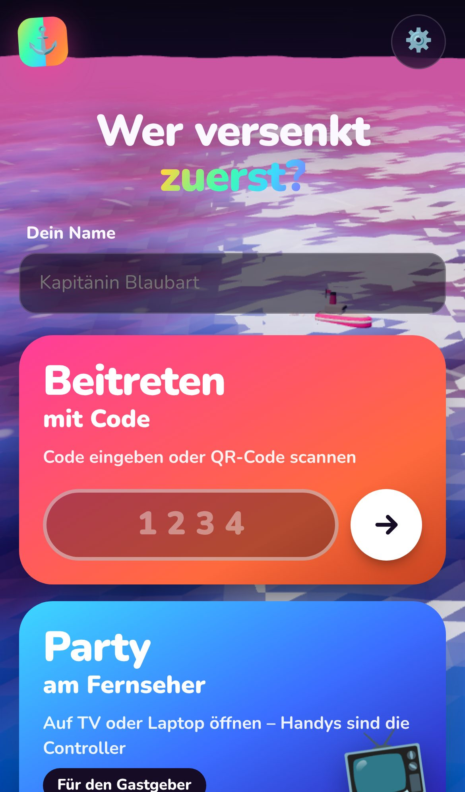</td>
    <td>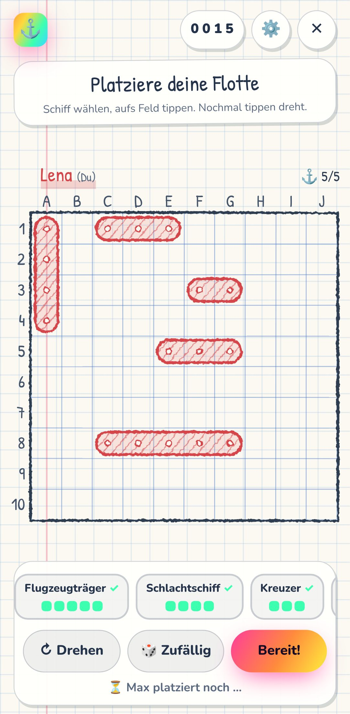</td>
    <td>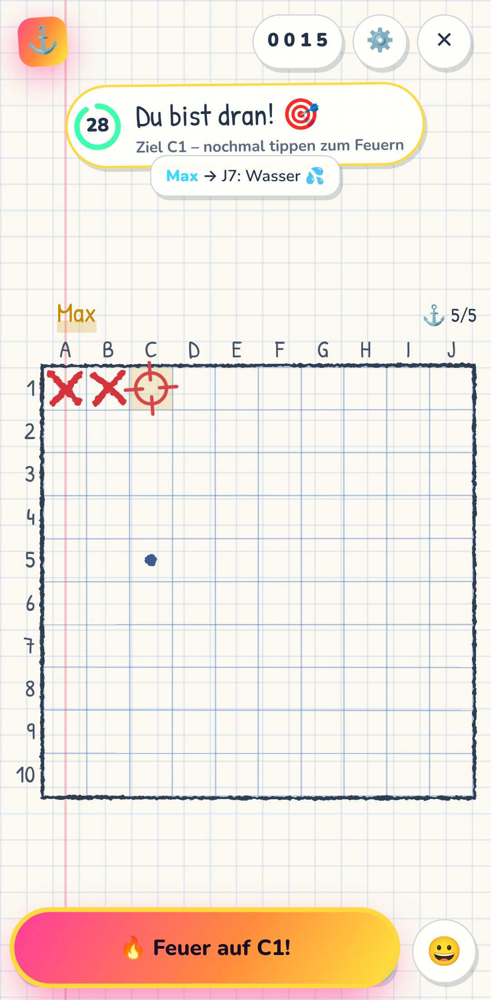</td>
    <td>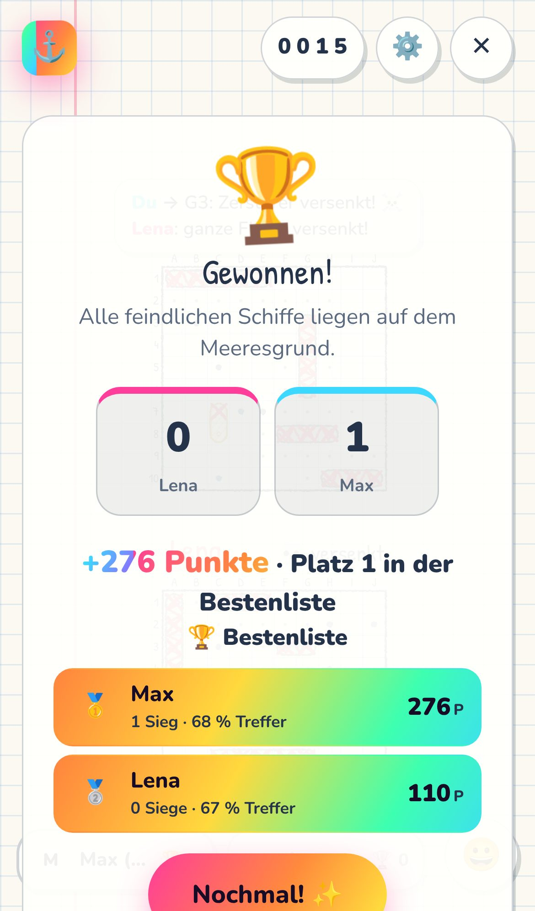</td>
  </tr>
</table>

---

## Spielmodi

| Modus | Für wen | Ablauf |
|---|---|---|
| 📱 **Gegen Freund** | 2 Menschen, jeder am eigenen Gerät | Raum erstellen, Freund scannt den QR-Code oder tippt den **4-stelligen Code** ein. Funktioniert im selben Raum oder übers Internet. |
| 🤖 **Gegen Bot** | allein | Sofort losspielen. Drei Stärken: 🪖 **Leicht**, ⚓ **Mittel**, 🎖️ **Schwer**. |
| 📺 **Party am Fernseher** | Familie & Freunde | Der Fernseher zeigt das Spiel groß, die Handys sind die Controller. Spielt nur ein Handy mit, übernimmt ein Bot den zweiten Platz. |
| 🍿 **Demo** | zum Zuschauen | Zwei Bots spielen gegeneinander, beide Flotten sind sichtbar. |

### Die Bots

Bots tragen lustige militärische Namen – der Dienstgrad verrät die Stärke:

| Stärke | Beispiele | Strategie | Ø Schüsse bis zum Sieg* |
|---|---|---|---|
| 🪖 Leicht | Gefreiter Gummiboot, Leichtmatrose Luftmatratze | meist zufällig, verfolgt Treffer nur manchmal | 67 |
| ⚓ Mittel | Kapitän Kanonenkugel, Korvettenkapitän Krabbe | „Jagen & Zielen“ im Schachbrettmuster | 44 |
| 🎖️ Schwer | Großadmiral Gnadenlos, Admiral Unversenkbar | Wahrscheinlichkeitskarte über alle noch möglichen Schiffslagen | 38 |

\* gemessen in 1.200 simulierten Spielen. Reines Raten bräuchte etwa 95 Schüsse.
Bots sehen nur, was auch ein Mensch sieht – sie schummeln nicht.

---

## So wird gespielt

**Die Flotte:** Flugzeugträger (5 Felder), Schlachtschiff (4), Kreuzer (3), U-Boot (3) und Zerstörer (2)
auf einem Feld von 10 × 10.

1. **Platzieren:** Schiff unten auswählen und aufs Feld tippen bzw. klicken. Nochmal antippen, `R` oder Rechtsklick dreht es.
   🎲 **Zufällig** verteilt die ganze Flotte. Schiffe dürfen sich **nicht berühren** – auch nicht diagonal.
2. **Countdown:** Sind beide bereit, zählt es auf allen Geräten gleichzeitig **3 – 2 – 1 – Feuer frei!**
3. **Schießen:** Wer dran ist, wählt ein Feld beim Gegner.
   - Am Handy: **einmal tippen = zielen** (alle sehen das Fadenkreuz live), **nochmal tippen oder 🔥 Feuer = schießen**.
   - Am PC: einfach klicken.
4. **Treffer? Nochmal!** Wer trifft, ist gleich wieder dran. Bei Wasser wechselt der Zug.
5. **30 Sekunden pro Zug** – danach feuert der Autopilot (auch für Spieler, deren Verbindung kurz weg ist).
6. **Gewonnen** hat, wer zuerst alle gegnerischen Schiffe versenkt. Mit **Nochmal!** startet die Revanche.

Rund um versenkte Schiffe wird das Wasser automatisch markiert – dort kann wegen der Abstandsregel nichts liegen.
Mit 😀 schickst du Emotes an den Gegner.

---

## Party am Fernseher

So spielt ihr zu zweit auf dem großen Bildschirm, jeder mit seinem Handy als Controller:

1. Server im Heimnetz starten (siehe [Schnellstart](#schnellstart)) – oder eine öffentlich erreichbare Installation nutzen.
2. Am Fernseher (Smart-TV-Browser, Laptop am HDMI, …) die Adresse öffnen und **„Party am Fernseher“** wählen.
3. Beide Handys scannen den **QR-Code** – fertig. Alternativ auf der Startseite den **4-stelligen Code** eintippen.
4. Am Fernseher **Spiel starten**. Ist nur ein Handy da, spielt ein Bot in der eingestellten Stärke mit.

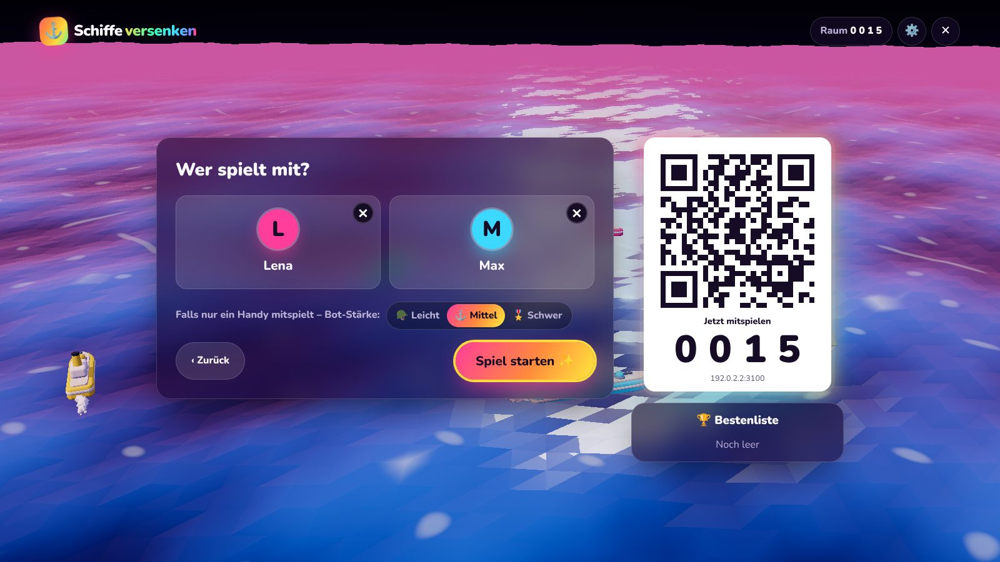

Der Fernseher zeigt **beide Spielfelder zentriert nebeneinander** – aber nie die Schiffspositionen, solange gespielt wird.
Wohin gerade gezielt wird, sieht man live am Fadenkreuz:

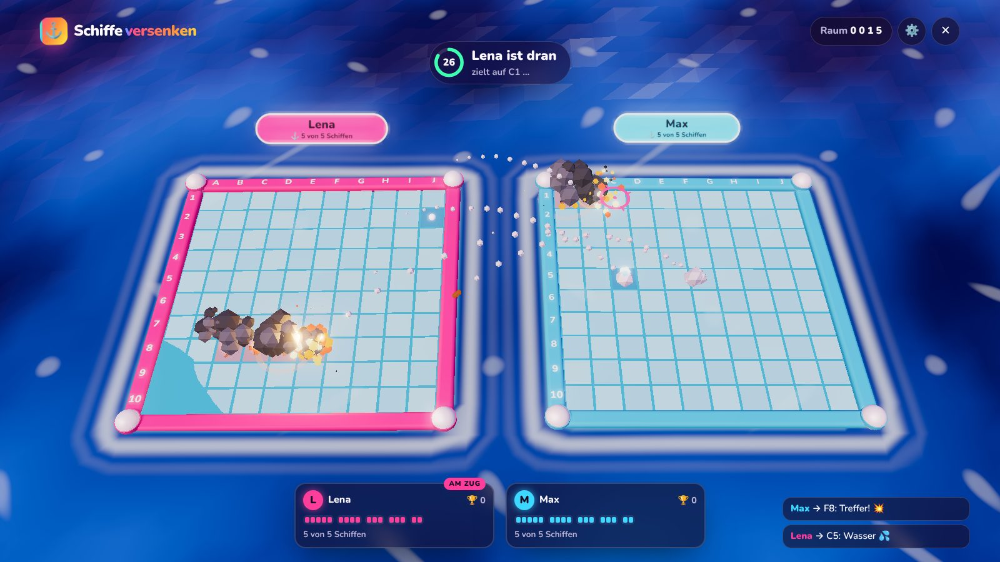

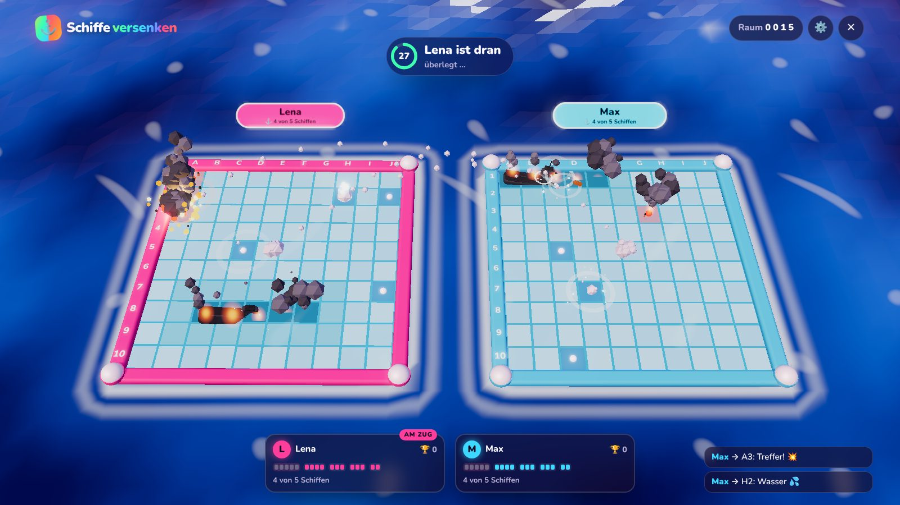

Am Ende gibt es das Ergebnis mit Punkten und Bestenliste:

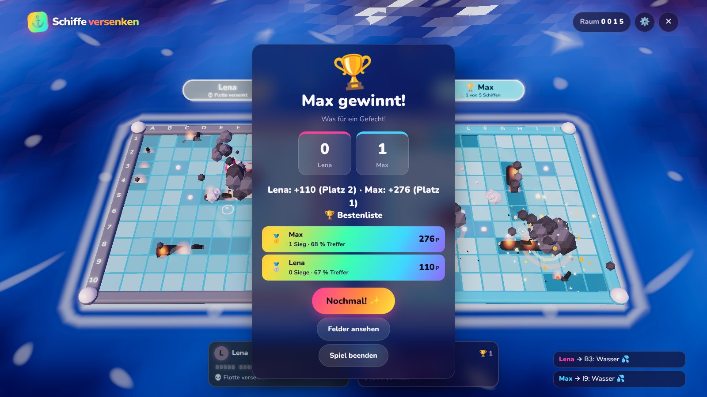

**Gut zu wissen**

- Der Fernseher ist der Gastgeber: Er kann Spieler entfernen (✕), die Revanche starten und das Spiel beenden.
- Handys behalten ihren Platz, wenn sie kurz die Verbindung verlieren oder die Seite neu laden.
- Steht die Lobby 5 Minuten leer, startet eine **Demo als Bildschirmschoner** – sobald ein Handy beitritt, endet sie.
- Die Handys nutzen als Controller immer die leichte Papier-Ansicht – präzise zu tippen und schonend für den Akku.

---

## Darstellung: 3D oder Papier

Über ⚙️ lässt sich jederzeit umschalten.

| | 🌊 **3D** | ✏️ **Papier** |
|---|---|---|
| Look | Abendmeer im HitYear-Farbverlauf, schwimmende Spielfelder, Low-Poly-Schiffe | kariertes Blatt, Bleistiftlinien, schraffierte Schiffe, Handschrift |
| Schüsse | Granate im Bogenflug mit Rauchspur und Mündungsfeuer | gezeichnete Bombe fällt aufs Feld |
| Treffer | Explosion mit Funken, Trümmern und Lichtblitz, das Schiff brennt, qualmt und bekommt Schlagseite | rotes Kreuz, „BUMM!“-Stern |
| Versenkt | Schiff kippt, sinkt unter Blasen und bleibt als qualmendes Wrack liegen | Schiff wird durchgekritzelt, „VERSENKT!“ |
| Wasser | Fontäne und Wellenring | Punkt, „platsch!“ |

**3D-Qualität:** *Normal* (ohne Schatten, weniger Partikel – Standard auf Handys) oder *Erweitert*
(weiche Schatten, Glühen, Sternenhimmel – Standard an PC und Fernseher).
Ohne WebGL springt automatisch die Papierversion ein.

Die fünf Schiffe als 3D-Modelle: Flugzeugträger mit Flugzeug an Deck, Schlachtschiff mit zwei Geschütztürmen,
Kreuzer, U-Boot mit Turm und Periskop, Zerstörer mit Flagge.

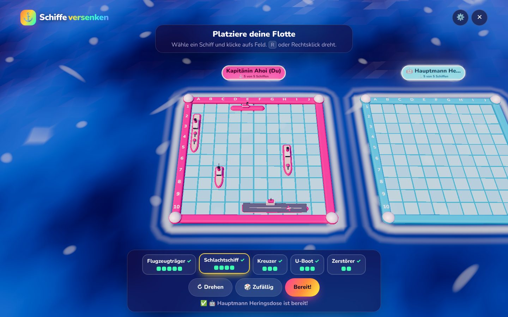

**Sounds:** Kanonenschuss, Wasserplatscher, Treffer, Untergang, Sieg, Niederlage, „Du bist dran“-Glocke,
Schiff setzen und Meeresrauschen – mit **ElevenLabs** erzeugt, mehrere Varianten pro Effekt.
Am Handy vibriert es bei Treffern.

---

## Bestenliste

Wie bei HitYear werden über alle Spiele je Name (ohne Groß-/Kleinschreibung) Punkte, Siege, Spiele und
Trefferquote zusammengezählt. Zu sehen auf der Startseite, im TV-Warteraum und nach jedem Spiel.

**Punkte pro Spiel**

| | Punkte |
|---|---|
| 🏆 Sieg | +100 |
| ☠️ je versenktem gegnerischem Schiff | +10 |
| 🎯 Trefferquote | bis +50 (Quote × 50) |

Gewichtet nach Gegner: **Mensch ×1,5** · Bot leicht ×0,5 · Bot mittel ×1 · Bot schwer ×1,5.
Bots, Demos und durch Verlassen abgebrochene Spiele zählen nicht.

---

## Schnellstart

Voraussetzung: [Node.js](https://nodejs.org) ab Version 18.

```bash
git clone https://github.com/WTK1611/schiffe-versenken.git
cd schiffe-versenken
npm install
npm start
```

Dann im Browser <http://localhost:3000> öffnen. Beim Start zeigt der Server auch die Adresse im WLAN an
(z. B. `http://192.168.1.20:3000`) – die brauchen Handys und Fernseher. Der QR-Code nutzt sie automatisch.

```bash
npm test
```

---

## Technik

- **Server:** Node.js mit `ws` (WebSockets), ohne Framework und ohne Build-Schritt. Der Server ist autoritativ:
  Gegnerische Schiffe verlassen ihn erst, wenn sie versenkt sind oder das Spiel vorbei ist.
- **Frontend:** HTML, CSS und Vanilla JS. 3D mit [three.js](https://threejs.org), Papierversion als SVG,
  Sounds über die Web Audio API.
- **Räume wie bei HitYear:** Host- und Spieler-Sitzungen (Neuladen = gleicher Platz), QR-Kurzlink `/s/<code>.<schlüssel>`
  mit Einladungsschlüssel, Grenzen je IP gegen das Durchprobieren von Codes, Aufräumen verlassener Räume.
- **Zeitliche Abgleiche** – alle Zeitpunkte sind Serveruhr, jedes Gerät kennt seinen Versatz:
  1. **Uhrabgleich:** 5 Pings, die schnellste Antwort zählt (bei jeder Verbindung und jede Minute).
  2. **Stand-Nummern:** Geräte melden alle 5 Sekunden ihren Stand und bekommen Verpasstes sofort (z. B. nach dem Standby).
  3. **Countdown** vor dem Gefecht, auf allen Geräten gleichzeitig.
  4. **Einschlag** jeder Granate auf allen Geräten im selben Moment.
  5. **Zugzeit** läuft erst nach dem Einschlag.
  6. **Neustart der Demo.**

```
server.js            HTTP + WebSocket: Räume, Spielablauf, Zeitabgleich, QR-Code
bot.js               Bot-KI (drei Stärken) und Namen
bestenliste.js       Bestenliste (Punkte, Speicherung als JSON)
shared/game.js       Spielregeln (Server und Browser)
public/js/main.js    Client: Netzwerk, Bedienung, Anzeigen
public/js/scene.js   3D-Welt (three.js)
public/js/ships.js   3D-Schiffsmodelle
public/js/paper.js   Papierversion (SVG)
public/js/sfx.js     Sounds
test/                Tests mit node:test
```

---

## Konfiguration & Betrieb

| Variable | Standard | Bedeutung |
|---|---|---|
| `PORT` | `3000` | HTTP- und WebSocket-Port |
| `BASE_URL` | – | Öffentliche Adresse für QR-Links, z. B. `https://schiffe.example.de` |
| `DATA_DIR` | `./data` | Ablage der Bestenliste – beim Betrieb auf einem Server auf ein dauerhaftes Verzeichnis legen |
| `TURN_SECONDS` | `30` | Zugzeit in Sekunden |

Läuft auf jedem Node-Host mit WebSocket-Unterstützung. Hinter einem Reverse-Proxy (Caddy, nginx) den
WebSocket-Upgrade für `/ws` durchreichen; `X-Forwarded-For/-Proto/-Host` werden ausgewertet.

---

## Lizenz

[PolyForm Noncommercial 1.0.0](LICENSE.md) – frei nutzbar, änderbar und weitergebbar, **nicht kommerziell**
(privat, Schule, Verein, gemeinnützig). Für kommerzielle Nutzung bitte über GitHub anfragen. Mitmachen ist erwünscht!

Schriften: Nunito und Patrick Hand (SIL Open Font License), Permanent Marker (Apache License 2.0) –
selbst gehostet, siehe `public/fonts/`. Bibliotheken: three.js, ws, qrcode (MIT).
